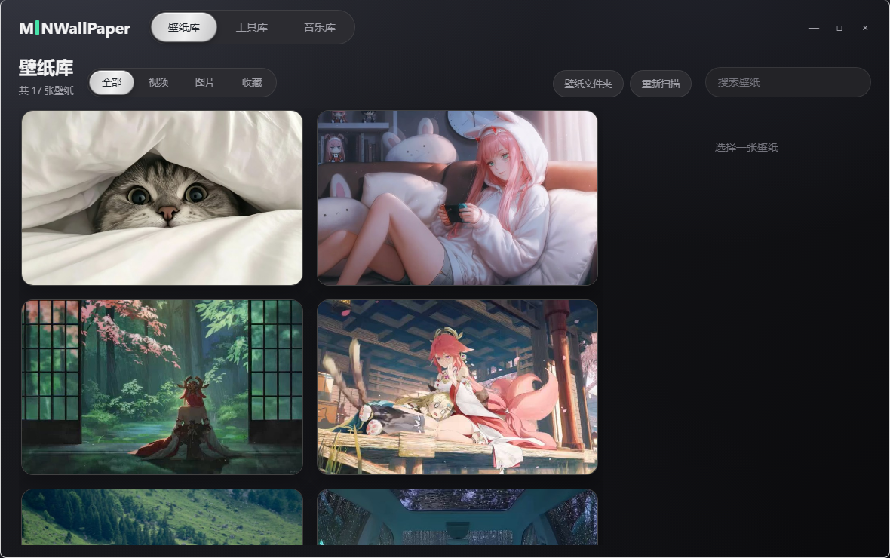
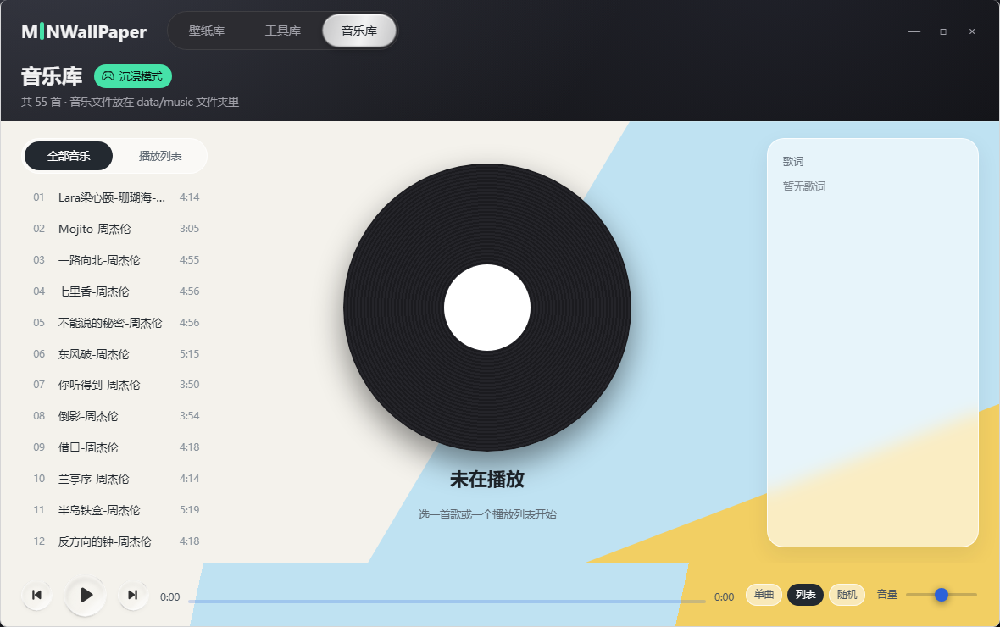

# MINWallPaper

一个轻量的 Windows 桌面工具：视频壁纸、唱片机音乐库和桌面小组件，全部离线运行。

界面用 WebView2 渲染，宿主是 .NET 8 WinForms。壁纸、音乐、播放列表、封面缓存都放在程序目录的 `data` 文件夹里，不上传、不联网。

## 截图







## 功能

**视频壁纸**
- Media Foundation 硬解，铺在桌面图标下方（WorkerW / Progman 双路径兼容）
- 支持 mp4 / mkv / mov / avi / wmv 等系统能解码的格式
- 播放卡住时自动重启；视频本身强制静音
- 图片壁纸交给系统壁纸接口，常驻内存接近零

**壁纸配乐**
- 每张壁纸可以绑定一个播放列表或单曲，切壁纸自动切歌
- 列表循环、单曲循环、随机播放
- 曲目搜索、音量同步，使用 NAudio 播放

**沉浸音乐库**
- 黑胶唱片、专辑封面、同名 `.lrc` 歌词逐行高亮
- 一键切换沉浸页：斜线切开当前页面，两片向左右推开
- 浅蓝 + 芥末黄配色，底部白蓝黄斜切播放条

**桌面小组件**
- 时钟：时间、日期、星期
- 音浪：跟随系统声音跳动的频谱
- 落雨：全屏细雨，鼠标可穿透，不挡桌面图标

## 下载

- 个人主页：<https://codecatio.github.io/home/#/tools/minwallpaper>
- GitHub Releases：<https://github.com/CodeCatIO/MINWallPaper/releases>
- Gitee Releases：<https://gitee.com/codecatio/minwallpaper/releases>

## 运行要求

- Windows 10 / 11 64 位
- .NET 8 Desktop Runtime
- WebView2 Runtime（Win11 自带，Win10 首次打开会提示安装）

## 从源码构建

```powershell
dotnet build -c Release
```

发布为不包含运行时的压缩包：

```powershell
dotnet publish -c Release --self-contained false -o publish
```

运行后会在 exe 旁边生成 `data` 目录：

```
data/
  wallpapers/     壁纸文件
  music/files/    音乐文件
  ...             播放列表、壁纸绑定、封面缓存
```

换电脑时直接拷贝整个 `data` 文件夹即可。

## 项目结构

```
Music/        音乐库、播放器、播放列表、封面提取、歌词
Native/       桌面层 WorkerW、窗口样式等原生调用
Pages/        WebView2 与前端之间的消息通道
Playback/     视频壁纸播放与看门狗
Storage/      壁纸索引、设置、音乐库索引
Web/          前端界面（单文件 index.html + 资源）
Widgets/      桌面小组件（时钟、音浪、落雨）
WallpaperHost.cs   壁纸宿主与桌面层挂载
WebLibraryForm.cs  主面板窗口
TrayContext.cs     托盘与启动逻辑
```

## 说明

- 仓库不包含任何壁纸、音乐或个人数据，`data/` 已在 `.gitignore` 中忽略
- 视频壁纸音轨强制静音，声音只来自音乐库
- 崩溃日志写在 `data` 目录下，方便排查

## 路线图

见 [ROADMAP.md](ROADMAP.md)。
